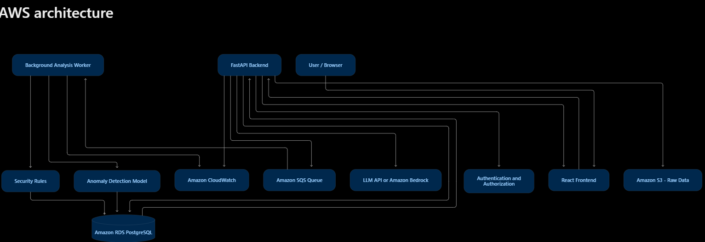

# SecurlyQ

**AI-powered security analytics for small IT teams.**
SecurlyQ ingests security events, detects suspicious activity with rules and machine learning, and explains each finding in plain English.

> Status: early development. Phases 1-5 (foundation, auth, detection rules, alerts API, anomaly detection, LLM explanations, dashboard) complete. See [docs/roadmap.md](docs/roadmap.md).

## What it does

1. **Collect** authentication, application, and network events through an API.
2. **Analyze** events with deterministic security rules and an anomaly detection model.
3. **Explain** each alert with evidence and recommended investigation steps.
4. **Investigate** alerts in a dashboard: filter, acknowledge, annotate, and track metrics.

SecurlyQ labels findings as *potentially suspicious*. It never claims an attack definitely occurred, and it never takes automated action.

## Target AWS architecture



## Repository layout

```
securlyq/
├── backend/            FastAPI service (API, rules, ML, persistence)
│   ├── app/
│   │   ├── api/        HTTP routes (thin: validate, call services, return)
│   │   ├── core/       Configuration and shared settings
│   │   ├── db/         Database engine, session, base class
│   │   ├── models/     SQLAlchemy table definitions
│   │   ├── schemas/    Pydantic request/response shapes
│   │   └── services/   Business logic (parsing, dedup; later rules, ML, LLM)
│   ├── app/ml/         Simulator, features, Isolation Forest, evaluation, training CLI
│   ├── app/llm/        Bedrock client, sanitizer, prompt, output validation, fallback
│   ├── migrations/     Alembic database migrations
│   ├── tests/          Automated tests
│   └── Dockerfile
├── frontend/           React + TypeScript dashboard (Vite, TanStack Query, Vitest)
├── infra/              Terraform for AWS (Phase 6)
├── docs/               Product brief, roadmap, ADRs, lesson notes
└── .github/workflows/  CI pipeline
```

## Quick start (local)

Requirements: Python 3.11+, Docker Desktop.

```bash
cp .env.example .env
docker compose up -d db            # start PostgreSQL
cd backend
python -m venv .venv
source .venv/bin/activate          # Windows: .venv\Scripts\activate
pip install -r requirements.txt
alembic upgrade head               # create the database tables
uvicorn app.main:app --reload
```

Open http://localhost:8000/docs for the interactive API documentation.

Try it (the first account you register becomes the admin):

```bash
curl -X POST localhost:8000/api/v1/auth/register -H 'content-type: application/json' \
  -d '{"email":"you@example.com","password":"a-long-passphrase"}'
TOKEN=$(curl -s -X POST localhost:8000/api/v1/auth/login \
  -d 'username=you@example.com&password=a-long-passphrase' | python -c 'import sys,json;print(json.load(sys.stdin)["access_token"])')

curl -X POST localhost:8000/api/v1/events -H "Authorization: Bearer $TOKEN" -H 'content-type: application/json' -d '[{
  "source": "auth-service", "event_type": "login", "outcome": "failure",
  "timestamp": "2026-10-28T12:00:00Z", "source_ip": "203.0.113.7", "username": "alice"
}]'

curl -X POST localhost:8000/api/v1/analysis/run -H "Authorization: Bearer $TOKEN"   # run detection
curl localhost:8000/api/v1/alerts -H "Authorization: Bearer $TOKEN"
```

Or use the **Authorize** button in the interactive docs at `/docs`.

Train the anomaly model and generate demo data (optional but recommended; without a model SecurlyQ runs rules-only):

```bash
cd backend
pip install -r requirements-ml.txt     # adds matplotlib for the report chart
python -m app.ml.train                 # ~5 s: trains, evaluates, writes models/ and docs/ml/
python -m app.ml.seed_demo             # 3 days of realistic traffic, then runs detection
```

Explain an alert in plain English (template by default; set `LLM_PROVIDER=bedrock` per [the setup guide](docs/aws/bedrock-setup.md) for model-written text):

```bash
curl -X POST localhost:8000/api/v1/alerts/1/explain -H "Authorization: Bearer $TOKEN"
```

Run the dashboard (needs the API running on port 8000; Vite proxies `/api` to it):

```bash
cd frontend
npm install
npm run dev                        # http://localhost:5173
```

Run the tests and linter:

```bash
cd backend
pytest
ruff check .
cd ../frontend
npm run typecheck && npm test
```

## Tech stack

Python, FastAPI, Pydantic, SQLAlchemy, Alembic, PostgreSQL, scikit-learn, React, TypeScript, Docker, GitHub Actions, AWS (App Runner/ECS, RDS, S3, CloudWatch, Secrets Manager), Terraform.

## Documentation

- [Product brief](docs/product-brief.md)
- [Roadmap](docs/roadmap.md)
- [Architecture decisions](docs/adr/)
- [Phase 1 lesson notes](docs/lessons/phase-1-foundation.md)
- [Phase 2 lesson notes](docs/lessons/phase-2-auth-and-detection.md)
- [Phase 3 lesson notes](docs/lessons/phase-3-data-science-and-ml.md)
- [Phase 4 lesson notes](docs/lessons/phase-4-llm-explanations.md)
- [Phase 5 lesson notes](docs/lessons/phase-5-dashboard.md)
- [Model evaluation report](docs/ml/evaluation.md)
- [Enabling Bedrock explanations](docs/aws/bedrock-setup.md)

## Known limitations

- Detection quality is evaluated on sample and synthetic data and does not establish real-world accuracy.
- Detection covers login activity only. Rules and the anomaly model are evaluated on synthetic data (see [evaluation report](docs/ml/evaluation.md)).
- LLM explanations are validated for safety but not yet scored for quality against analyst judgement, and the live Bedrock integration has been tested only with a stubbed client.
- Alerts are not updated after creation; evidence for an attack still in progress is not appended by later runs.
- The dashboard keeps its sign-in token in sessionStorage (readable by injected scripts); an httpOnly cookie is planned for Phase 7. There is no alerts-over-time chart yet because the API has no time-series endpoint.
- Login rate limiting is per-process memory; production scale needs Redis or an edge WAF.
- Rules are evaluated on a time window you choose; an attack straddling two separate runs may yield two alerts.
