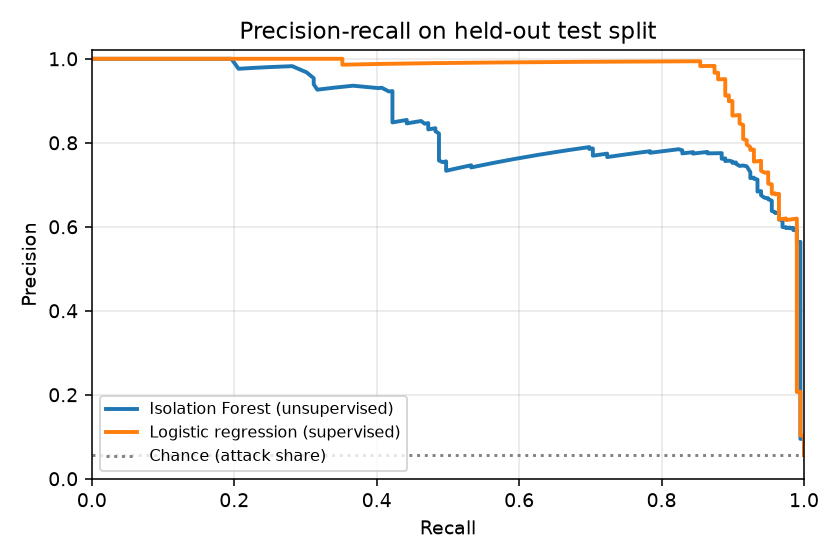

# Anomaly detection evaluation

> Generated by `python -m app.ml.train`. **Synthetic data**: these numbers compare approaches on simulated
> traffic we generated ourselves. They do **not** establish real-world detection accuracy.

Model: `isolation-forest-v1` | seed `7` | alert threshold `0.9455` (chosen on the validation split, never on test).

## Data splits (chronological, disjoint attacker IPs)

| Split | Buckets | Attack buckets | Attack share | Attack incidents |
|---|---:|---:|---:|---:|
| train | 7071 | 369 | 5.2% | 86 |
| val | 2522 | 104 | 4.1% | 25 |
| test | 3528 | 199 | 5.6% | 46 |

## Test-split results

Bucket level = each (IP, 10-minute window). Incident recall = share of attacks flagged at least once.

| Approach | Precision | Recall | F1 | FPR | False alerts / day | Incident recall |
|---|---:|---:|---:|---:|---:|---:|
| Rules only | 0.74 | 0.41 | 0.52 | 0.009 | 2.07 | 0.89 |
| Isolation Forest only | 0.78 | 0.82 | 0.80 | 0.013 | 3.21 | 0.98 |
| Hybrid (rules OR model) | 0.76 | 0.89 | 0.82 | 0.017 | 3.93 | 1.00 |
| Logistic regression (supervised, reference) | 0.96 | 0.88 | 0.92 | 0.002 | 0.57 | 0.98 |

Ranking quality of the Isolation Forest score: ROC-AUC **0.989**, PR-AUC **0.848** (a useless model would score about 0.056).

## Incident recall by attack scenario

| Scenario | Rules only | Isolation Forest only | Hybrid | Logistic regression |
|---|---:|---:|---:|---:|
| brute_force | 11/11 | 11/11 | 11/11 | 11/11 |
| compromise | 5/5 | 5/5 | 5/5 | 5/5 |
| credential_stuffing | 12/12 | 12/12 | 12/12 | 12/12 |
| low_and_slow | 3/8 | 8/8 | 8/8 | 8/8 |
| multi_ip_takeover | 10/10 | 9/10 | 10/10 | 9/10 |

## How to read this honestly

- Every number is from one seeded simulation; with a few dozen incidents, differences of a few points are noise.
- The rules were written with these attack shapes in mind, so synthetic rule scores are optimistic.
- `low_and_slow` is deliberately stealthy; see which approaches miss it and why.
- Re-running with another `--seed` shows how much the results move.
